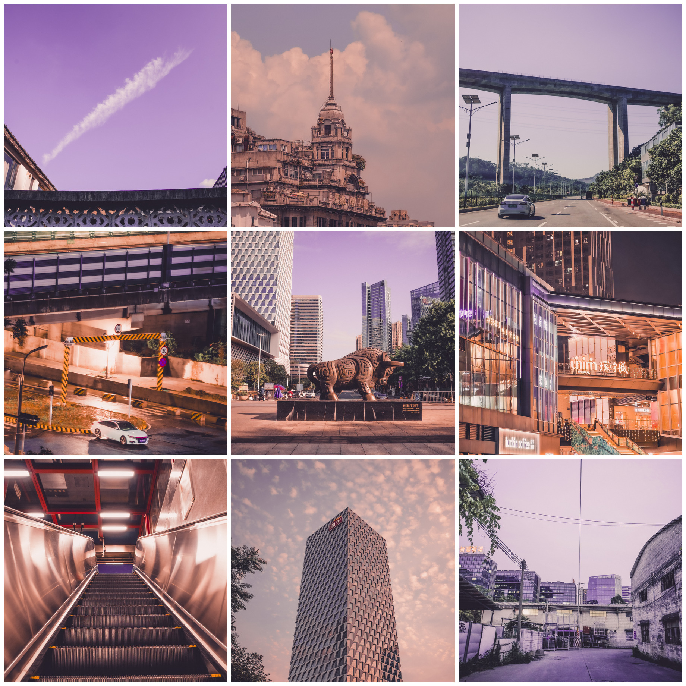

# 雷猴世界·GTA6

一款通用的 GTA6 风格滤镜：保留插画感的影调，按 GTA6 官方海报的配方上色——**暗部紫、中间调粉、高光橙**，紫、粉、橙是核心色，天空会由紫向粉、橙过渡。套完一般只需调曝光、高光、阴影。

## 预设总表

| 预设 | 适合的照片 | 色调 | 参考来源 |
|---|---|---|---|
| `雷猴世界-GTA6` | 城市街景、高楼建筑、天空云彩、高架桥梁、商场夜景、地铁扶梯等室内灯光 | 插画感影调（暗部大幅提亮、清晰度高纹理低），黑位抬起、白位收住的粉彩海报感；天空染紫，云和亮部偏桃粉，暖光变橙铜，黄、绿、青被压淡 | 网上流传的 GTA 滤镜（影调基线）+ Rockstar 官网 9 张横版官方海报（配色） |

## 预览

`预览/` 里是在 Lightroom 中套用本预设后导出的成片，`封面.jpg` 为其中九张的拼图。

| 文件 | 场景 | 套用后的样子 |
|---|---|---|
| `DSC06066-2.jpg` | 晴天屋檐与飞机云 | 蓝天整片变成紫色，云保持白 |
| `IMG_20250902_125525-2.jpg` | 老建筑与积云 | 云和楼面偏桃粉，天空淡紫 |
| `DSC06715.jpg` | 高架桥、公路 | 天空淡紫，路面和桥偏冷灰，树木仍保留一些绿 |
| `DSC00080.jpg` | 高架下的路口（傍晚） | 灯光和路面偏橙，桥体带紫 |
| `1791246946000_R0006970.jpg` | 城市广场雕塑 | 天空淡紫，地面和雕塑偏暖铜 |
| `IMG_20260103_194154-2.jpg` | 商场夜景 | 室内暖光变橙，玻璃幕墙和夜空带紫 |
| `R0000050.jpg` | 地铁扶梯 | 金属和灯光偏粉铜，暗部带紫 |
| `R0000037.jpg` | 高楼与鱼鳞云 | 云层粉橙，楼体暖棕 |
| `R0003583-2.jpg` | 旧厂房小巷（阴天） | 整体淡紫，灰白墙面偏薰衣草色 |

## 参考来源

- **影调基线**：用户从网上找到的 GTA 滤镜（`准备素材/GTA6/成片与预设/GTA6.xmp`），用户评价"百搭、很多场景都适用"。插画感来自它的影调：阴影 +89、白色 -100、黑色 -79、清晰度 +44、纹理 -47。已在 `工具/预设生成器.py` 中 1:1 复刻为 `GTA6_REF`。
- **配色配方**：Rockstar 官网横版官方海报 9 张（Pre_Load、An_Extended_Look、Launch_Trailer、Lock_And_Load、Rooftop、The_Album、hero、Vice_City_27、音乐页主视觉），来自 `rockstargames.com/VI` 与 `rockstargames.com/VI/media`。
- **取色方法**：把每张海报按亮度分 5 段，统计每段的平均色相、饱和度，以及黑位、白位。结论：
  - 颜色**跟着亮度走**：暗部蓝紫 / 紫（色相约 260–280）→ 中间调蓝紫到粉 → 亮部粉（约 320–345）→ 最亮处红橙 / 橙（约 16–35）。天空顶部暗所以紫，靠近太阳亮所以橙，这就是紫橙渐变的来源。
  - 饱和色几乎只有蓝紫、蓝、紫、粉、红、洋红，**黄、绿、青接近 0**。
  - 黑位（最暗 1%）约 30–50，白位（最亮 1%）约 222–242：黑抬起、白收住。
- **对照**：网上那款 GTA 滤镜的成片，暗部和中间调是天蓝 / 青（色相约 180–205），没有紫和粉，白位接近死白，所以"不太像 GTA 的配色"。
- 具体参数与每项依据写在 `工具/预设生成器.py` 的 `雷猴世界-GTA6` 注释里；改色请改参数表后重新生成，不要手改 `.xmp`。

## 相对基线的改动

影调核心参数（曝光 +1.10、对比 -17、高光 +20、阴影 +89、白色 -100、黑色 -79、纹理 -47、清晰度 +44、去朦胧 -7、鲜艳度 +56、饱和度 -21、色温 +16、颗粒 13）与基线相同。改动分三组，每组相互独立，可以单独回退：

| 组 | 目的 | 改了什么 |
|---|---|---|
| A | 紫→粉→橙 渐变 | 颜色分级：阴影改为蓝紫，新增中间调粉，高光改为橙 |
| B | 去掉黄、绿、青，放出紫、粉、橙 | HSL：黄推向橙，绿和青压低，蓝推向蓝紫，红偏粉红，紫、洋红、橙提饱和 |
| C | 粉彩海报感 | 色调曲线：黑位抬高、白位收住，对齐官方黑位与白位 |

## 版本记录

| 版本 | 内容 | 结果 |
|---|---|---|
| 场景 7 款（已撤下） | 海滨、晴天、黄昏、夜景、夜店、室内冷光、室内暖光，按官方图取色 | 各场景都不好看：只改颜色，没有插画感影调 |
| 百搭（已撤下） | 基线 + 蓝色色相 +15（天空推紫） | 只考虑了紫色，破坏了天蓝和青 |
| 微调版（已撤下） | 基线 + 蓝色色相 -5、紫/洋红饱和放开 | 与基线几乎一样，没有意义 |
| 重做 v1 | 影调不动，颜色体系重做（天蓝、奶油桃粉） | 整体偏黄 |
| 重做 v2 | 黄色色相 -30 → -55，高光色相 20 → 5 | 橙不够橙，紫也缺，没有官方海报的紫橙渐变 |
| 当前（v3） | 按 9 张官方海报的分段配方重做：颜色分级三段 + HSL + 曲线端点 | 已在 LR 中套用并导出 9 张预览（见上） |

## 使用提示

- 曝光基线是 +1.10，原片偏亮时容易过曝：套用后先调**曝光**，再按需调**高光、阴影**。
- **蓝天会整片变紫**，晴天大蓝天的照片变化最明显；阴天、灰白天空会变成淡紫。
- **暖色灯光会变成橙、铜色**，夜景和室内会同时出现紫和橙。
- 天空的蓝推向蓝紫、青推向蓝，**海水、泳池也会偏紫蓝**，不再是碧青色。
- 黑位抬高、白位收住，画面没有纯黑纯白，是故意做的粉彩海报感。
- 预览里都是城市、建筑、天空和灯光场景，还没有人像样张；用在人像上时肤色会变成什么样还没试过，请先自行试用。
- 导入方法：LR「修改照片」→ 预设面板「+」→「导入预设」，选中本文件夹里的 `.xmp`。

## 测试状态

| 预设 | 状态 |
|---|---|
| `雷猴世界-GTA6` | v3 已在 LR 中套用 9 张照片（城市、建筑、天空、夜景、室内灯光），见 `预览/`；人像未试 |
