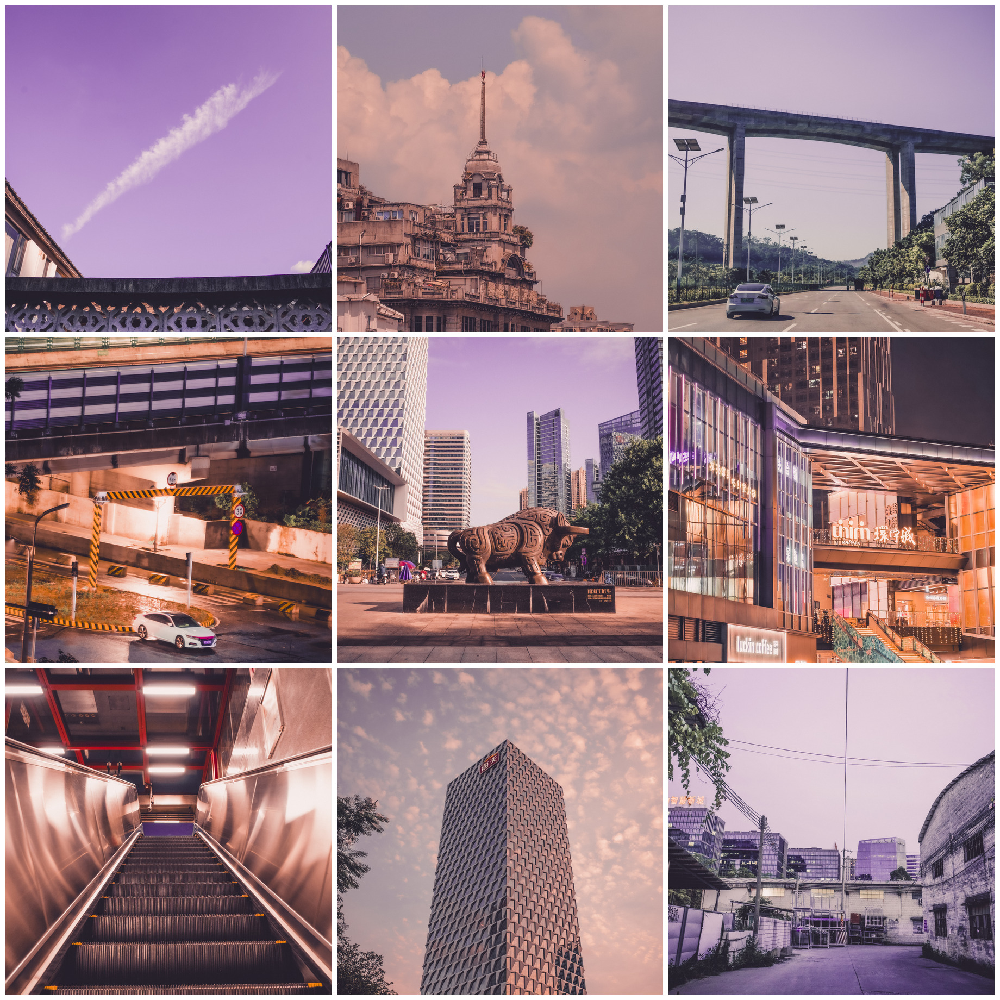
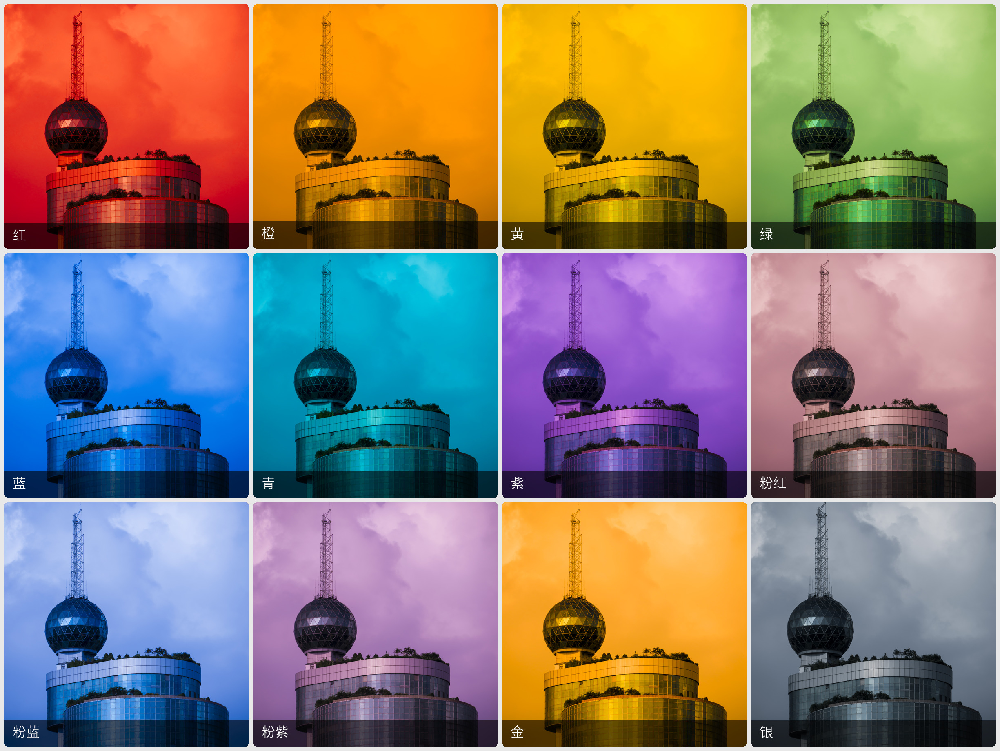
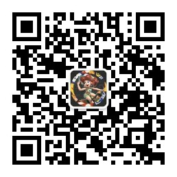

# 雷猴世界 · LR 预设库

Lightroom 预设库，按专辑收录。

一张专辑对应一种调色方向。同一张原片，一组预设，把它的可能性一次看完——不用装插件，导入就能用。

预设为 `.xmp` 文件，Lightroom Classic、Lightroom CC 与 Adobe Camera Raw 通用。

## 安装

**Lightroom Classic / Camera Raw**

`文件 → 导入配置文件和预设`，选中 `.xmp` 即可。也可以手动放进 `ImportedSettings` 目录，重启后生效：

- macOS：`~/Library/Application Support/Adobe/CameraRaw/ImportedSettings/`
- Windows：`%APPDATA%\Adobe\CameraRaw\ImportedSettings\`

所有专辑都放在 [`LR滤镜预设/`](LR滤镜预设/) 文件夹里，一张专辑一个子文件夹。每张专辑都附有成片和「滤镜说明」，可以先看效果再决定导入哪一个。

---

## 专辑

### 雷猴世界 · GTA6

[查看专辑 →](LR滤镜预设/雷猴世界·GTA6/)

一款通用的 GTA6 风格滤镜，照着 GTA6 官方海报的配方调：暗部紫、中间调粉、高光橙，天空由紫向粉橙过渡，画面带一层插画感。

城市街景、高楼建筑、天空云彩、夜景商场、室内灯光都能用。套完一般只需调曝光、高光、阴影。

### 雷猴世界 · 一色一味

[查看专辑 →](LR滤镜预设/雷猴世界·一色一味/)

十二种单色倾向：红、橙、黄、绿、青、蓝、紫、粉红、粉紫、粉蓝、银、金

套上就变，不是微调：整张照片的调性会一次性换掉，不需要再逐项调参数。套完之后一般只需补一点曝光。

---

## 公众号

新预设会先在公众号发，偶尔写点摄影文章、商业故事。平时看动漫、打游戏、扫街，同好可以关注。

---

## 版权

预设版权归 雷猴世界 所有。

**禁止商用，禁止转售。** 不许拿它去卖钱，也不许打包进任何付费产品、课程或素材包里转手。

个人使用、免费分享给朋友都没问题；转载或公开发布请注明出处。
